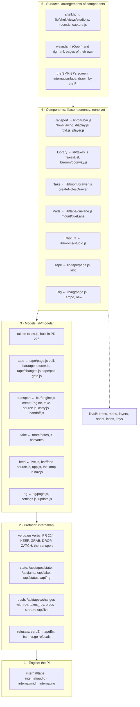

# Components, models and the protocol

> A spec, not yet agreed. It works out the ecosystem's steps 4 and 5
> (`the-ecosystem.md`, Direction B) and the protocol under them. Nothing in
> it is built but the verbs (#224) and the takes model (#225). Gabe,
> 2026-10-30: *"get to a point where we're not trying to make changes to the
> entire app but to small individual components in a more targeted way."*

Each decision has a recommendation. *For Gabe*, at the end, lists the ones
that change a rule he made.

**The boundary.** This spec is surface ↔ engine: what a page's models ask
the Pi and hear from it. Engine ↔ engine (the tape as a portable document,
and sync between a Pi, a phone and the hub) is `the-pocket-kit.md` (#228,
open). Both use the same words: a **tape** has **tracks**, a track holds
**parts**, a **take** is a recording on the shelf, and a **version** is a
number that moves when a noun's state does.

## The layers, and today's modules on them



## 1. The component contract

**1.1 One signature.** Recommended:

```js
// lib/components/transport/index.js
export default {
  id: 'transport',
  needs: ['transport', 'tape', 'takes'],   // its models, by noun
  css: 'css/bar.css',                      // its one stylesheet
  mount(root, models, cx) {                // once per root
    // …
    return { show() {}, hide() {}, unmount() {} };   // each optional
  },
};
```

A surface mounts it with `mountComponent(def, root, models, ctx)`
(`lib/components/mount.js`, new), which makes `cx` from the shell view's
`ctx` (`lib/shell/view.js`) and answers `{ show, hide, unmount }`. It is the
ecosystem's `mount(root, model, {layers, toast})` with the models plural
(the Transport needs three) and `cx` for the options:

| `cx` | What it is | From |
|---|---|---|
| `watch(model, fn)` | `fn(snapshot)` now and on each `onChange`; never while hidden, once more on show; off on unmount | new, over the models' `onChange` |
| `on(target, type, fn)` | a listener on `window` or `document` (a key), quiet while hidden | `ctx.on` |
| `loop(fn)` | a step on the shared ticker, parked while hidden | `ctx.loop` |
| `layers` | its scope of the page's stack: what it opens closes on hide and unmount | `ctx.layers` |
| `floor()` | where its menus stop above the bar | today `barTop(document)` (`lib/ui/menu.js`), which reads `#np` from anywhere |
| `toast`, `go` | words for a person; a move to another room | `ctx.toast`, `ctx.go` |
| `id(name)` | the id of a part of it: its root's id and the name (`np` and `play` make `np-play`), for `aria-controls`, `<label for>` and the flows | new |

No `every` and no `socket`: polling and sockets are the models'.

**1.2 The lifecycle.**

- **mount** runs once per root. It fills the root from the component's
  template, binds its keys, watches its models and draws from their
  snapshots. It never waits on the network: a model with no answer yet
  says so in its snapshot, and the component draws its empty state.
- **show** and **hide** are the surface's, run inside the view's own (so
  after the turn: `shell.md`, *Moving between rooms*). `mountComponent`
  does the gating, so a component remembers nothing about being hidden:
  its watchers, keys and loops go quiet on hide and wake on show, and its
  layers close. Its own `show` measures; its own `hide` stops what it runs
  outside `cx` (an audition). In a view that is mounted out of sight
  (decision 0048) its components are mounted hidden and hidden again before
  their first show, which the gating covers: show replays every watcher.
- **unmount** is real, unlike a view's `destroy`, which the router never
  calls: a workspace that rearranges (the ecosystem's step 6) and the
  harness (4) both unmount. `mountComponent` takes off everything that went
  through `cx` and empties the root; the component's own `unmount` undoes
  the rest (a `ResizeObserver`). Its test mounts, unmounts and mounts again
  and counts listeners: a key bound twice is how Space once pressed ▶ twice
  (`view.js`'s header).

**1.3 Inside its root, and nowhere else.** A component reads its models'
snapshots, watches them, calls their verbs, and draws inside `root`. It
never:

- fetches, opens a socket, or names a route (`/api/…`): that is a model's;
- touches the DOM outside `root`: no `document.getElementById`,
  `document.querySelector` or `document.body` (a drag's ghost, a sheet: a
  `lib/ui` interface);
- writes an id of its own: the surface gives the root its id, and every id
  inside is `cx.id()`'s, made from it;
- says or hears a page-wide event (`hindsight:*`): it calls a verb, or a
  callback the surface passed in;
- keeps a press machine, menu, layer or sheet of its own: taps, double taps
  and holds are `pressMachine` or `bindPress` (`lib/ui/press.js`), menus
  `menu()` or `splitKey()`, what opens goes on `cx.layers`, a sheet is
  `createSheet`, a key's picture is `icon()`;
- makes audio, or moves `location` or the history.

**Its markup is its template**, in its module, cloned into the root. The
bar's zones and `data-for` stay (decision 0047), but there is one copy of
its keys where there are two now (`#np` is written out in `shell.html` and
again in `wave.html`). A key is still declared in markup, in its slot,
never appended by a script; it is named in the template (`data-part="play"`)
and given its id at mount (`cx.id('play')`).

**The flows keep finding it.** A root given the id `np` makes `#np-play`,
`#np-grabber` and the rest as they are now, so the `#np…` ids the flows
select (at least nineteen) stay. About a dozen of the bar's 45 ids don't
start with `np` (`#position`, `#clock-out`, `#rec`, `#catch-pass`,
`#catch-more`, `#click`, `#tape-overview`, `#out-strip` and its parts).
They are renamed in the extraction (`#np-position`…), with each flow's
selector and the LCD ids in the guardrail *Step 5a* moved to the new names
in the same PR: the selectors change, never what a flow expects.

**1.4 Its stylesheet.** A component is a place, so decision 0033 holds as it
is: one file in `css/` per component (the Transport's is today's
`css/bar.css`), linked by each page that arranges it, after `styles.css`,
in `sw.js`'s `SHELL`, and read by tests through `cssOf(page)`. Three rules
make it the component's alone:

- **Scoped to its root.** Every selector in it starts at the root's class
  (`.np`). Another stylesheet may name the root only to place it (the root
  itself: where it sits, its size, `#np`'s view-transition name in
  `css/rooms-motion.css`) or to lay out around it (`body:has(.np)`, as
  `styles.css` keeps the toasts above the bar); never to style what is
  inside it. `styles.css` does that once today, Play mode's toggle
  (`.np > .play-toggle`), which goes with Play mode's flag.
- **Laid out by its own width**: a container query on its root, as
  `bar.css` already has on `.np-row-1`, never the viewport's `@media`,
  which is a surface's. So the harness can mount it at any size and see
  what a page would. `bar.css` has six viewport `@media` blocks today, and
  sets the dock's `--dock-b` on `body`: the first become container queries,
  the second goes to the surface's stylesheet.
- **Told its state on its root**, never by the page's body classes:
  `bar.css` keys rules on `body.player-open` (thirty times), `body.np-fold`,
  `body.tape-page`, `body.shelf-page`, `body.main-page`, `body.wave-page`,
  `body.selecting` and `body.notes-open`. They become attributes on the
  root (`data-size` and `data-source` are already there), set from the
  models and the surface.

All of that moves in the Transport's extraction.

A component reads only tokens for its colours, type and materials
(`the-play-look.md`), so a theme restyles it wherever it is mounted.

**1.5 Enforced by directory, not by list.** `architecture.test.js` gains
Guardrail 15, over every file in `lib/components/` (comments stripped, tests
left out, as Guardrails 11 to 14 read them). It fails on:

- `fetch(`, `WebSocket`, `connectSocket`, or a `'/api/` string;
- `document.getElementById`, `document.querySelector`, `document.body`;
- an `addEventListener` on `window` or `document`, and `setInterval`;
- `hindsight:`, `new Audio`, `location.`;
- an id written in (`id="`, or `.id =` given a string);
- a `setTimeout` beside a `pointerdown` in one file (a hold of its own);
- in its stylesheet, a selector that doesn't start at its root, and in any
  other, a selector that reaches inside its root (`rules()`,
  `lib/stylesheets.js`);
- a component that doesn't export `{ id, needs, css, mount }`, or has no
  harness check (`scripts/components/<id>.check.mjs`).

Guardrails 12 and 13 (`pushState`, `aria-haspopup`) already cover it. The
directory is new, so the guardrail starts green with nothing on a list: a
module moves in only once it keeps every rule, and there is never an
`OWN_*` list for it (decision 0021).

## 2. Models per noun

**2.1 The shape #225 set**, made the rule for all six (`lib/models/<noun>.js`,
no DOM):

- **One per page**, made by the page (`lib/shell/boot.js`; Open's
  `lib/wave/page.js`) and handed down: to views on `ctx` (`ctx.takes`), to
  components through `mountComponent`.
- **`snapshot()`**: the state as a frozen plain object, the same object
  until it changes, with its version (`v`). The takes model's `list()` and
  `etag` become `snapshot().list` and `snapshot().v`, the old names kept
  until their callers move.
- **`onChange(fn)`**: `fn(snapshot)` on each change; it answers a way off.
- **Verbs**: async methods named for what they do. Each resolves with the
  Pi's answer or throws a `Refusal` (3.4). A press shows at once: what was
  asked and not yet answered is in the snapshot (`pending`), as the bar's
  tape source keeps `want` today (`lib/bar/tape-source.js`). So a tap
  answers at once wherever it is made, as decision 0018 asks of the
  keyboard's presses, and that is the model's job, not each key's.
- **`heard(m)`**: a message from the push socket (3.3), fed by the page's
  one socket. A version not heard before asks the Pi.
- **It asks only while someone looks.** `cx.watch` tells it who is shown,
  so a model with no shown reader asks nothing, as the takes model's
  `get()` from the shown room's tick does now. Its fallback poll, for a
  socket that is down, is decision 0013's rate, still Gabe's to set.

**2.2 The six.**

| Model | The state it owns | Push or poll | Its verbs (the route today) |
|---|---|---|---|
| `tape` | the loaded tape (its tracks, parts, sections, grid, loop and cue lane) and the Pi's state around it (the armed tracks, the inputs, undo and redo); the list of tapes | `rev`, then one `GET /api/tapes/state` for the page. Today the Studio polls it at 200 ms (`lib/tape/page.js` `poll`) and the bar at 500 ms (`tapeSource`), handing over by `delegate` and `ingest` | `edit(op)`, the sections' ops among them (`/api/tapes/edit`); `rename`, `setLoop`, `arm`, `setInput`, `setClick` (`PATCH /api/tapes`); `undo`, `redo`; `load`, `create`, `clone`, `remove`; `catch`; `record`, `punchOut` (`/api/tapes/record`); `paste` (`/api/tapes/drop`); `launch` (`/api/tapes/cue`); `grab(from)`, from the feed, an armed input or a take's span (`/api/tapes/cue/grab`); `drop` (`/api/tapes/cue/drop`); `mixdown`, `send` |
| `transport` | what the bar plays (the tape, a take or the feed), playing, where (heard, at, the sample rate), the loop, the tempo, where it plays (jam room, phone, both; this device), the alignment | the tape's `rev`; a take and the feed are local (the engine's audio); the playhead runs on the ticker between answers | `play`, `stop`, `locate` (`/api/tapes/transport`); `setSource`, `loadTake`, `eject`; `setOutput` (`PUT /api/tapes/output`); `setTempo`, `halve`, `double` (`PATCH /api/tapes`, then `tempo.md`'s re-grid); `tapLoop`, a free loop's tap (`/api/tapes/tap`) |
| `takes` | the take list and its ETag; the trash | `takes_rev` (#225) | `keep(from)`, the feed's last seconds or a span of it (`/api/trigger`) or a cue clip (`/api/tapes/cue/keep`); `remove(names)` (`/api/delete`), `restore` (`/api/trash/restore`), `star(names)`, `exportURL(names)` |
| `take` | one take: its name, ★, tag, tempo, notes, family, peaks | `takes_rev`, then `GET /api/take` if its entry moved | `rename`, `star`, `tag` (`PATCH /api/take`); `note`, `editNote`, `removeNote` (`/api/take/flags`); `undo` (`/api/take/undo`); `cut` (`/api/cut`); `remove` |
| `feed` | the always-on ring: healthy, waiting, saving, the last error and the last save, how much it holds; the levels; the envelope; the MIDI clock in | the levels on `/api/live` (the one stream); the rest from `/api/status`, one poll a page (seven modules poll it today, the Studio tab's lamp among them) until it has `feed_rev` | `flag`, `unflag` (`/api/flag`) |
| `rig` | the interface, its inputs and outputs and their labels; the Pi's settings, version, disk and MIDI devices; the controller's bindings; latency in use | polled while the rig, Settings or Releases is shown, until it has `rig_rev` | `setLabels` (`PUT /api/rig/labels`), `saveSettings` (`PUT /api/settings`), `restart`, `install(tag)` (`POST /api/update`), `setControls` (`PUT /api/tapes/controls`) |

**A verb is the model's of the noun it lands on**, whatever it is pressed
from: GRAB, DROP and CATCH are the tape's (the feed's strip, a take's notes
and the keyboard all GRAB onto its cue lane), KEEP is the takes' (it puts a
take on the shelf). So each verb has one caller on the page, as it has one
method on the Pi (`Verbs`).

The phone's recorder (`lib/phone/recorder.js`, `phoneRecorder`) already has
the shape (one per page, `state()`, `onChange`, its verbs) and is handed to
components as it is.

**2.3 Fixture models.** Every model is made over the page's protocol
client: `createTape({ protocol })`. The client (`lib/models/protocol.js`,
new) is the one module that names a route: models ask it by noun and verb
(`read('tape')`, `verb('transport', {action})`), and it answers with
versions, throws the one `Refusal`, and fans the page's one socket out to
each model's `heard`. It is built on what is there, not beside it:
`lib/link.js` (`timedFetch`, `onResume`, the *Reconnecting…* note, already
on `ctx.link`) and `lib/socket.js` (`connectSocket`). A fixture
(`lib/models/fixture.js`) is a protocol client that answers reads from a
JSON snapshot and records verbs, so `createTape({ protocol: fixture(json)
})` is a tape with no Pi. It can script a verb's answer or its refusal
(`{refuse: {play: 'no_audio_out'}}`), so a component's refused press is
checked too.

- **The snapshots** are what the Pi answers, saved:
  `testdata/protocol/<noun>/<case>.json` (an empty tape, four tracks
  playing, a take with notes, the feed failing…), beside the pocket kit's
  `testdata/conformance/`. They are outside `release.yml`'s `paths`, so a
  new fixture cuts no release.
- **They can't drift**: a Go test in `internal/api` checks that the demo's
  answer to each read still has its fixture's shape.
- `fixture.js` is for tests and the harness only, and stays out of
  `SHELL`. It names no route and opens nothing, so no guardrail needs to
  skip it.

**2.4 Where today's code fights it.** Work, in the PR that moves each
caller:

- **Two pollers of one state**: the Studio's and the bar's, above. One
  `tape` model ends the hand-off.
- `/api/status` is polled by seven modules (`app.js`, `lib/nav.js`,
  `lib/settings.js`, `lib/update.js`, `lib/shell/views/room.js`,
  `lib/bar/feed-source.js`, `lib/rooms/studio.js`); `/api/live` is opened
  by `app.js` and `lib/rooms/studio.js`; the list of tapes is asked for by
  six (`lib/nav.js`, `lib/tape/page.js`, `lib/tape/listener.js`,
  `lib/rooms/grab.js`, `lib/bar/tape-source.js`, `lib/wave/page.js`).
- **The bar's engine is the transport model with the bar drawn inside
  it**: `createEngine` (`lib/bar/engine.js`) makes `NowPlaying`, sets
  `$('np-eject').hidden`, and wires `phoneKey` to `document`.
- **`PATCH /api/tapes`** takes about fifteen optional fields and infers the
  kind of undo from which are set. The model names each now, so moving to
  named edits (3.1) changes one file.
- **About fifteen page-wide events** carry state between modules
  (`hindsight:tape-state`, `verb`, `tape-changed`, `play-transport`,
  `keeps`, `cue-select`, `cue-selected`, `np-fold`…). Each becomes a model's
  `onChange` or a verb.
- **Each model's PR moves every caller of its routes and adds a guardrail
  naming them**, as Guardrail 14 does for `/api/jams` (which then names
  `lib/models/protocol.js` in place of `takes.js`): a route is the
  protocol client's once nothing else asks it, and no list of exceptions is
  kept.

## 3. The protocol, surface ↔ engine

**3.1 The verbs.** #224 made `Verbs` (`internal/api/verbs.go`) the one set
for KEEP, GRAB, DROP, CATCH and the transport: the tablet's routes and a
controller's pads call the same methods. Recommended next:

- **Every write is a named method on the Pi**, as the verbs are. The edits
  (`internal/tape/edit.go`, `timeedit.go`) and `PATCH /api/tapes`'s fields
  become the
  pocket kit's named edits (`{edit: "part.add", id, base, made, by}`), so a
  tap on the tablet and a phone's sync are one path.
- **The routes stay as they are until then.** The models are their only
  callers, so renaming one later touches `lib/models/` and nothing else.

**3.2 State per noun, with a version.** Each read says its version in its
body (`v`) and as its ETag, and answers 304 to `If-None-Match`, as
`/api/jams` does:

| Noun | Read | Version |
|---|---|---|
| tape, transport | `GET /api/tapes/state` | `rev` (`Engine.Changes()`). It is on the socket but not in the answer today: add it, so a model drops an answer older than one it holds instead of counting its own polls (`lib/tape/poll-gate.js`). The pocket kit's `version` (the edits its home has applied) for the tape document, when there is one |
| takes, take | `GET /api/jams`, `GET /api/take` | `takes_rev` (#225); a take's own ETag, new (`/api/take` sends none today) |
| feed | `/api/status`'s capture half | `feed_rev`, new: it moves on healthy, waiting, saving, a save, an error. The levels stay a stream |
| rig | `/api/rig`, `/api/settings`, `/api/tapes/controls`, `/api/status`'s other half | `rig_rev`, new |

**3.3 The push: keep the nudge (decision 0013).** Recommended: the socket
goes on saying versions, not the state.

- **Why.** One way in for each noun's state: the same read serves the first
  load, a wake, a missed message and a nudge. Many edits make one read. And
  the pocket kit chose the same for engines (*Down as snapshots*). The cost
  is a read after the nudge, about 20 ms of the 30–50 ms the push takes
  (`STATE.md`, *The push, timed*); look again only if that timing, at the
  rig, says it is too slow.
- **One socket for every noun**: `{rev, takes_rev, feed_rev, rig_rev,
  at_ms}`, and the tape's `version` once it has one, beats included, with
  the events that are not state (the keyboard's `press`) beside them, as
  now.
- **Served with the tape off**, at `/api/changes`, with
  `/api/tapes/changes` kept for a protocol version. Today it is a 404 with
  the tape off (`handleTapeChanges` asks `tapeOff` first), so Capture, which
  is what `/` shows then, hears no `takes_rev` and polls.

**3.4 Refusals and errors: one shape.** Today a refusal is `{"error": "…"}`,
sometimes with `"reason": "recording"` (`tapeErr`); its status comes from
`verbErr` or `tapeErr`, the keyboard's words from `banner.go`'s
`refusals`, and a page reads it with `lib/tape/refusal.js`. Recommended: one
table on the Pi, a row per error with its status, a stable `code` and the
banner's `words`, which the route, the keyboard and the page all read:

```json
{"error": "arm a track first", "code": "not_armed", "words": "NO TRACK ARMED"}
```

- `error` is for a person, in the Pi's words, as now; `code` is what a page
  tests, never the prose; `words` is the short form a key or the banner
  shows.
- `reason: "recording"` becomes `code: "recording"`, and `reason` stays for
  one protocol version.
- A failure that isn't the Pi's (offline, a timeout) is thrown in the same
  shape by the protocol client (`code: "offline"`), so a component handles
  one kind of `Refusal`.

**3.5 Versioning.** Recommended: one integer for this protocol, said in the
socket's first message and by the pocket kit's `GET /api/kit` (which says
what the engine is, what it can do and which sync protocol it speaks).
Today's routes are protocol 1.

- A change a page from before can live with (a field, a verb, a noun)
  keeps the number. One it can't (a route gone, a field that means
  something else) moves it, and the Pi answers both for a release.
- The service worker can keep a page older than the Pi it talks to: a page
  whose number is behind the Pi's offers the update, and calls nothing
  that has gone.

## 4. The harness

Recommended: **`scripts/components.mjs`**, beside `scripts/flows.mjs`, with
its page, its server and one check per component in `scripts/components/`.
Nothing under `scripts/` is in `release.yml`'s `paths`, so changing a check
cuts no release.

- **It mounts one component alone**, on fixture models:
  `node scripts/components.mjs transport` mounts the Transport with each of
  its fixtures (the tape stopped and playing, a take, the feed, a refusal)
  in a bare page that links `styles.css`, `objects.css` and the component's
  sheet, and nothing else. A change to the Transport is checked by that, in
  seconds.
- **No demo, no Go.** A small node server serves `web/static` read-only,
  the harness page at `/__components/`, and `testdata/protocol/`.
- **Sizes and schemes**: the phone (390×844), the Pixel tablet (1280×800),
  1024×768 and the desktop (1440×900), from `PROFILES` in
  `scripts/flows/harness.mjs`, each in light and dark.
- **The flows' layout rules, imported, never copied**: `checkLayout` from
  `scripts/flows/layout.mjs` (covered, offscreen, menu-offscreen, clipped,
  target-size, small-touch), and any check added there later, such as one
  for the bar's keys on a phone. `checkLayout` needs a `root`, so
  it counts only what is inside the component: a new option, built first. A
  component starts with no findings: nothing of it goes into
  `layout-known.json` or `layout-allow.mjs`.
- **In CI**: a step in the `flows` job, which already installs Playwright
  and Chromium, before the flows run. A finding fails it. Its pictures go
  into the storyboard, so a look before merging (decision 0042) has every
  size and scheme in one place.
- **Beside the flows**: the flows stay the end-to-end truth, a journey
  across components and the Pi with real taps on the demo (decision 0043).
  The harness checks one component's shape at every size. An extraction
  changes no flow and adds its component's check.

## 5. Surfaces as arrangements (a sketch)

A surface is a module (`lib/surfaces/<name>.js`) that makes roots and mounts
components into them with the page's models; a shell view becomes one. The
walkthrough decides what is on each.

| Surface | Its components | |
|---|---|---|
| Tablet: Jam | Capture, Pads, Tape (heads and lanes, the loop), Transport | the Studio at rest; J1.16's budget holds |
| Tablet: Build | Tape (the editor), Tempo, the clip's drawer, Transport | the Studio with the editing open |
| Tablet: Listen | Library (the wall or the List), Take, Transport | the Listening Room |
| Phone | Library (the List), Take, Transport (the mini player, a sheet), Capture (record from this phone) | listen, light edits, share |
| Laptop | Build and Listen side by side, Rig | a surface of its own, or desk work: the walkthrough's |
| SMK-37 | none | drawn by the Pi from the same state (`internal/surface`) |

## 6. Build order

Each its own PR, changing no behaviour (the flows unchanged), naming its
interfaces (decision 0022), with its file under `docs/architecture/` in the
same PR. A new directory under `lib/` goes into `ci.yml`'s globs and
AGENTS.md's list (decision 0024).

**Foundations**

1. `lib/components/mount.js` (`mountComponent`, `cx`) and its tests, and
   Guardrail 15 over an empty `lib/components/`.
2. `lib/models/protocol.js` and `fixture.js`; the takes model moved onto
   the client, with `snapshot()`; `testdata/protocol/` and its Go shape test.
3. The harness: `scripts/components.mjs`, and `checkLayout`'s `root`.

**Models**, each moving every caller of its routes and adding its route
guardrail: `tape` and `transport` together (the bar's engine split from
`NowPlaying`, its sources moved to `lib/models/`); `take`; `feed`; `rig`.
On the Pi, beside them: `rev` in the tape's answer, `/api/changes`, the
refusals' one table, `GET /api/kit`.

**The first five extractions**, each into `lib/components/<id>/`:

| | Component | What moves | Models | What it fixes on the way | Flows that must not move |
|---|---|---|---|---|---|
| 1 | Transport | `lib/bar/bar.js` `NowPlaying`, `display.js`, `fold.js`, `player.js`, `slots.js`, `take-keys.js`, `source-menu.js`, `phone-key.js`, `press-note.js`; `#np`'s markup out of `shell.html` into its template; `css/bar.css` | transport, tape, takes (the source menu), the phone's recorder | its `$('np-…')` lookups; the `MutationObserver` that reads `body.tape-page` to know whether the tempo opens a menu (the surface says so); a `window` keydown that reads `dialog[open]` off the page; `lib/tape/page.js` reaching into the bar for ●, Catch and the click (`$('rec')`, `$('catch-pass')`, `$('click')`: they become the Transport's keys on the tape's verbs); `barTop`; the `matchMedia` for the phone's player; `hindsight:np-fold` | J1.10, J1.12, J1.13, J1.15, J1.16, J2.3, J4.1, J4.4 |
| 2 | Library: the List | `lib/takes.js` `TakesList`, and its *Recently deleted* row (`lib/trash.js` `TrashList`) | takes, take, transport (a row plays in the bar) | six fetches of its own (`/api/take`, `/api/peaks`, `/api/take/undo`, `/api/delete`); its two holds, a row's and select's, on `bindPress` as the wall's spines already are (`SPINE_PRESS`); select mode onto the stack (`STATE.md`, *Leftovers*); `#select-btn` and `#sel-*` | J2.5, J2.6, J2.7 |
| 3 | Library: the wall | `lib/room/doorway.js`, `shelves.js` (pure, as it is), the wall's half of `lib/shell/views/room.js` | takes, transport | its `$()` lookups; the search found as `#shelf-q` (*For Gabe*); Sort ▾ and the chips as the library's state, shared with the List | J2.2, J2.7 |
| 4 | Take: the notes drawer | `lib/room/drawer.js` `createNotesDrawer`, its `source` the take model (`barNotes`, `lib/room/notes.js`, becomes it) | take, transport, tape (a note's GRAB) | appending itself to `doc.body`: it mounts in the root the surface gives it, docked or as a sheet | U3, J2.4 |
| 5 | Pads | `lib/tape/cuelane.js` `mountCueLane` | tape (the cue lane), transport (the dial's playhead) | `hindsight:cue-select` and `cue-selected` (which clip is open becomes the tape model's); its drag's ghost on `document.body` and its look-ups of `.tape-track` across the page. A drag from one component onto another is a `lib/ui` interface, built first (`lib/ui/drag.js`: drop targets registered by roots) | C1, J1.6 |

Open's bar (its own markup in `wave.html`, driven by `lib/wave/page.js`)
moves onto the Transport in a PR of its own, in Open's pass. Then Capture
(`lib/rooms/studio.js`: the ribbon, KEEP, GRAB, Flag; feed, tape and
takes), the clip's drawer (`lib/buffer/`), Rig (`lib/rig/page.js`), and the
Tape editor last (`lib/tape/page.js`: about 140 ids, about eighteen `window` and
`document` listeners, the holds in `STATE.md`'s *Leftovers*). Tempo is
built new on the contract (`tempo.md`), not extracted: the first component
that never lived in a page.

## For Gabe

1. **The bar's keys in the Transport's template**, not in `shell.html` and
   `wave.html`: decision 0047's *in the markup* moves from the pages'
   markup to the component's, one copy for both.
2. **The search's id.** AGENTS.md says to give `#shelf-q` its behaviour *by
   its id, wherever the header puts it*. A component has no page id: the
   search becomes the library's state, put in the header by the surface.
3. **The push socket at `/api/changes`, served with the tape off**, with
   versions for the feed and the rig on it.
4. **The refusal shape** (`code`, `words`), and `reason` retired after a
   protocol version.
5. **The fallback poll** (decision 0013), which every model now shares.
6. **Whether the laptop is a surface of its own** (the walkthrough).
