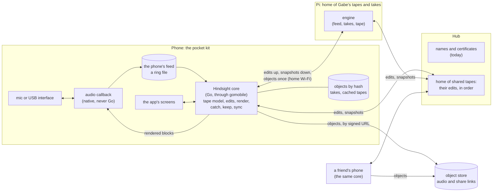

# The pocket kit: Hindsight on a phone that records on its own

> A spec, not yet agreed. Nothing here is built, and nothing in it changes
> the app until Gabe has answered the questions at the end. It is the
> ecosystem's *away* story (`the-ecosystem.md`, *Away, sharing, other
> people*) and the walkthrough's *On the phone* and *Playing with other
> people* (`walkthrough.md`), worked out far enough to choose.

## Where it came from

Jamming on the Orchid, Gabe hit the limits of its looper. He wanted to play
guitar and a drum machine over the loop he'd made, but the Orchid went to
sleep after five minutes, and there was no way to keep the jams he was
coming up with. Hindsight started there, and it fixed it at home: the Pi
is always recording. The phone in his pocket is the one thing he always
has with him, and today it can only record into the Pi.

## What he wants

- **A native phone app that is a Hindsight client** and records and
  renders locally, for low latency.
- **Away from the Pi** the phone keeps its own feed, and a copy of the tape
  kept in sync, with the same live edits as the tablet.
- **Later, other people**: friends or his brother overdub on a shared tape,
  and the piece becomes a collaboration.
- **Android first** (his phone). iOS if it becomes a product, designed for
  now so that iOS isn't a re-architecture.

The walkthrough's note is the frame for all of it: *the tape's format and
the sync protocol should be the contract every engine meets, with shared
conformance tests; no one codebase is the contract.*

## The pieces



The five layers of `the-ecosystem.md` hold: the phone is a second
**engine**; it speaks the same **protocol** as the Pi; its screens are the
same **models** and **components**; the phone is one more **surface**.
What is new is that two engines can each hold a tape, so the protocol has
to carry a tape between them, which today it never does: *nothing syncs
between devices* (`the-ecosystem.md`, *What is there today*).

**This spec is the engine ↔ engine half**: the tape as a portable
document, and sync between the phone, the Pi, the hub and a friend's
phone. The screen ↔ engine half (the verbs, each noun's state with its
version, the events on the push socket, the refusals) is
`docs/plan/components.md`'s, and nothing here specifies it again. The two
use the same words: tape, take, track, part, version.

## 1. The tape as a portable document

### A tape on the Pi today

From `internal/tape/model.go`, `store.go` and `docs/architecture/tape.md`:

- **One `tape.json`** in `TAPE_DIR/tapes/<id>/`, schema `Version = 1`. The
  id is the folder's name (`2026-10-30_sunday-groove`). Beside the state:
  the name, `sample_rate`, `length` in frames, `created`, the click, the
  armed tracks (`rec_tracks`) and each track's input.
- **The state** (`tape.State`, what undo steps through): the grid, the loop
  (`in`, `out`, `on`), the tracks (name, bus A or B, gain, pan, mute,
  solo, parts), the cue lane, the sections and the style (wow, flutter,
  drive, age).
- **A part** (`tape.Clip` in the code) is a window onto a pool WAV:
  `file`, `src` and `frames` in the file, `at` on the tape, a `layer`, its
  gain, nudge, fades and their curves, where it came from (`source`,
  `clean`, `aligned`), and for a reversed part the file it was reversed
  from. Its id is `c` and eight hex characters (`NewClipID`).
- **The pool**, `TAPE_DIR/audio/`, is shared by every tape, the clipboard
  and the crate. A file is written once (32-bit integer PCM behind the
  44-byte header `audio.writeWAVHeader` writes, and nothing else), never
  changed, and named by when it was made: `catch_2026-10-30_211403.wav`.
  Clean-up deletes what no tape, history, clipboard or crate still
  reaches.
- **Every position is in frames** at the tape's rate. The grid is
  `{frames, bars}` in 4/4, and the tempo is derived from it
  (`docs/plan/tempo.md`).
- **Undo** is up to 100 earlier copies of the whole state in the same file,
  and one Undo steps back whoever made the edit. Every edit goes through
  `Tape.Change`, which validates the result before it is saved.
- **Edits never touch audio** but one: Reverse writes a new pool file.

A take is a WAV in `OUTPUT_DIR` and its sidecars
(`docs/architecture/takes.md`): `.meta.json` (name, star, tempo,
downbeat, notes, origin, the tape a bounce came from), peaks, a preview
MP3, its MIDI, and a `.history.json` of per-device operations, each with
its value before and after, so one device's Undo never overwrites a
change made since on another.

### What wouldn't travel

Most of this is already the right shape: a tape is an edit list over
immutable audio. Five things tie it to one Pi:

1. **Pool files are named by time, not content.** Two engines catching in
   the same second make the same name for different audio, and the same
   audio on two devices has two names. Nothing can say "I already have
   that".
2. **Ids are local.** A tape's id is a date and a slug; a part's is 32
   random bits. Fine on one Pi, not across devices and people.
3. **Undo is whole copies of the state.** It can't merge with edits made
   elsewhere, and it makes the file up to 100 times the size of the tape.
4. **Device state is mixed in.** The armed tracks, the inputs and the click
   sit in `tape.json`, though the code already says they are *"where you
   are, not what's on the tape"* (`model.go`, `Tape`).
5. **Derived files sit beside the audio**: peaks, previews, a take's cue
   chunk (the notes, written into the WAV, so a take's bytes change when a
   note does).

### The format

**Recommended: a tape is a document of three parts: audio objects named by
their hash, a snapshot of the state, and the edits since.** Today's
`tape.json` stays the Pi's working file; the portable form is what an
engine exports, imports and syncs, and a Pi can keep a tape in both.

#### Audio objects

- **An object is immutable audio named by the SHA-256 of its canonical
  bytes**: `sha256-<64 hex>`. Canonical is what the Pi already writes
  (`writeWAVHeader`): RIFF, a 16-byte `fmt ` chunk, `data`, nothing else;
  32-bit integer PCM, interleaved, little-endian. Anyone can check an
  object with `sha256sum`.
- **A take's audio is an object too**, hashed over its canonical form (its
  WAV without the cue chunk), so a note never changes what the audio is.
- **Derived files are not objects**: peaks, previews, waveforms. Each
  engine makes its own. A reversed part's file is an object (it is audio
  the renderer plays) and keeps naming what it was reversed from.
- **On disk**, `objects/sha256/<first 2>/<the rest>.wav`, as git lays out
  its own. The Pi indexes its existing pool files by hash the first time
  one is exported; new pool files can be written under their hash at once.
- **On the wire** an object may travel compressed, as long as the receiver
  rebuilds the canonical bytes and checks the hash before using it. At
  first the WAV travels as it is (*Battery and storage* has the sizes); a
  lossless codec on the wire is a later, measured change that alters no
  id.
- **One rate per tape**: a tape names its sample rate (48 kHz for every
  tape so far), every object on it is at that rate, and an engine whose
  device runs at another resamples at its edge, as `/api/phone` already
  does for a phone recording.

#### The tape document

A snapshot, which is today's state with three changes: global ids, objects
by hash, and who made each part. Shortened:

```json
{
  "format": "hindsight-tape", "format_version": 2,
  "id": "t-01JBX4Q7Z9…", "name": "Sunday groove", "home": "pi:<kit id>",
  "sample_rate": 48000, "length": 57600000, "version": 312,
  "grid": {"frames": 384000, "bars": 4},
  "loop": {"in": 0, "out": 384000, "on": true},
  "tracks": [
    {"n": 1, "name": "MPC", "bus": "A", "gain_db": -6, "pan": 0,
     "parts": [{"id": "p-01JBX4R2…", "object": "sha256-9b1c…",
                "src": 4800, "frames": 384000, "at": 0, "layer": 0,
                "gain_db": 0, "by": "u-gabe", "made": "2026-10-30T21:14:03Z"}]}
  ],
  "cue": {"clips": []}, "sections": [], "style": null
}
```

- **Ids are ULIDs** with a prefix (`t-` a tape, `p-` a part, `s-` a
  section, `u-` a person, `d-` a device): unique without asking anyone, and
  in time order. The slug stays as the tape's folder name on a Pi.
- **`home`** names the engine that orders this tape's edits (*Sync*).
- **`by`** is the person who made the part (*Identity*).
- **Device state stays on the device**: the armed tracks, the inputs, the
  click, where it plays. They are not in the document.
- **The bus is kept** (A or B): the Sidekick's strips on a Pi; an engine
  without strips plays both.
- **Unknown fields are kept.** An engine reads what it knows and writes
  back what it doesn't, untouched, so a Pi a release ahead of a phone loses
  nothing through it. An unknown `format_version` is refused with words
  saying to update.

#### The grid and tempo

Unchanged from today and from `tempo.md`: `{frames, bars}` at the tape's
rate, 4/4, the BPM derived. If `tempo.md`'s re-grid lands (move the bar
lines, leave the audio), a tempo change is one edit to `grid` and moves no
part, which is what makes it easy to sync: it can't conflict with a part.
A meter other than 4/4 would be a new field, read as 4/4 when absent.

#### Versions

- **The edits are the history.** Each change is one edit (below), named
  for what it does. The snapshot's `version` is how many edits its home has
  applied: the tape's version, in the sense `components.md` gives each
  noun's state, and what an ETag says.
- **An edit** is small and says what it means:

  ```json
  {"edit": "part.add", "id": "d-pixel:41", "by": "u-gabe",
   "base": 309, "made": "2026-10-30T21:14:03.120Z/2",
   "track": 3, "part": {"id": "p-01JBX5…", "object": "sha256-77ad…",
                        "src": 4800, "frames": 384000, "at": 768000}}
  ```

  `id` is the device and its own count, so a resend is recognised and
  applied once (as a chunk number is in `/api/phone`). `base` is the
  version the device had when it made the edit. `made` is when, on a clock
  that never runs backwards (a hybrid logical clock: the device's time,
  and a counter when two edits share a millisecond).
- **The kinds of edit** are today's: the ones `PATCH /api/tapes` infers,
  the edits in `edit.go` and `timeedit.go`, the cue lane's and the verbs
  that change the tape (CATCH, DROP). Each becomes a named edit with one
  meaning, which is also the ecosystem's *one verb set* carried one layer
  down. `Tape.Change` stays where every edit is validated.
- **A document can be cut down** to a snapshot alone (to send a tape) or a
  snapshot and the edits after some version (to sync). The home keeps the
  edits as long as a device might still undo one (*Undo*), then folds them
  into the snapshot.

#### Takes

A take keeps its form on the Pi; the portable form is the same idea:
`{id, object, meta}`, with the meta as `.meta.json` has it, plus `by`, the
device it was kept on, and its own version for its meta edits, which already
go one field at a time with a before and an after (`audio.Op`). Takes and
tapes share the objects store, so a bounce and the parts it was made from
are found from one another, the walkthrough's *Projects*: a bounce's meta
already names its tape (`tape_id`).

## 2. Sync

### Each tape has a home

**Recommended: one engine orders each tape's edits, its home, and every
other copy is a replica that works offline and sends its edits there.**
Gabe's tapes and takes live on his Pi, as now. A shared tape's home is the
hub (*What the hub does*). A tape made on the phone with no Pi in reach is
homed on the phone until its first sync, when the Pi adopts it, edits and
all: nobody else has it, so there is nothing to merge.

Why a home, and not a peer-to-peer merge (a CRDT such as Automerge, where
every copy converges with no one in charge): a tape is small and coarse,
tens of parts and a few dozen numbers, and edits by different people
rarely touch the same thing. A home gives one order to show, one place for
the rules below and for Undo, and one version number, and it is how
Figma's multiplayer works for the same reasons
([Figma, *How Figma's multiplayer technology works*](https://www.figma.com/blog/how-figmas-multiplayer-technology-works/)).
The cost: two replicas can't sync with each other without the home; they
each wait to reach it.

### Down as snapshots, up as edits

- **Down**: a replica fetches the home's snapshot when it hears the
  version moved (the nudge of decision 0013 and `docs/architecture/push.md`,
  with the tape's version beside `rev` and #225's `takes_rev`). It never
  receives a stream of other people's edits, so 0013's rule, *one way in
  for the state*, holds for engines as it does for pages.
- **Up**: a replica sends its own edits, never its state. Until the home
  acknowledges them, the replica shows the home's snapshot with its own
  pending edits applied on top, so its screen never waits on the network.
- **Live at home**: with both on the Wi-Fi, an edit goes up as it is made
  and the snapshot comes back on the nudge, about as fast as the tablet
  follows a keyboard press now (30–50 ms, `push.md`). That is *the same
  live edits as the tablet*.

### Audio moves only once

- **Objects before edits.** A replica asks the home which objects it lacks
  (`have` with a list of hashes, answered with `missing`), uploads those,
  then sends the edits that use them. The home refuses an edit naming an
  object it doesn't hold, with the list, so an edit never lands half-done.
- **Uploads resume.** An upload names its object and its offset; after a
  dropout the sender asks how far the home got and carries on, the rule
  `/api/phone` already keeps for a live recording. The home checks the hash
  when the last byte lands and keeps nothing that doesn't match.
- **Once per place.** An object is stored once however many tapes, takes or
  people use it, and a phone that has cached a tape's audio never fetches
  it again. A catch dropped on two tapes is one object.
- **The feed never syncs.** Neither the Pi's ring nor the phone's leaves
  its device; only what someone kept or caught does.

### Offline first

The phone does everything on its own copy: keep, catch, edit, undo. A
queue holds the objects and edits not yet sent, in order, on disk, and
drains whenever the home is in reach. Nothing on the phone ever waits for
the Pi or says it can't, and nothing is lost when the app is killed
mid-upload.

### Who wins a conflict

The home applies an edit made against an older `base` by these rules, in
order. **Recommended**; the alternatives are in *Questions*.

| Two edits | What happens | Why |
|---|---|---|
| Touch different things | Both apply | The common case: you on track 1, a friend on track 3 |
| Both record over the same span | Both are kept, on layers | Today's always-overdub rule (`State.Place`); a part is never thrown away for another |
| A *replace* catch over a part added since | The new part stays, layered | A replace removes only what its author could hear (the parts in its `base`) |
| Set the same thing (a gain, a fade, a name, the loop, the grid) | **The last one made wins** (by `made`), not the last to arrive | Someone who edited offline at 6 doesn't undo what was done online at 9 |
| Change a part someone removed | The removal wins; the change is reported back | Nothing is lost: the part's audio is still an object, and the removal is undoable |
| Insert or delete time, and an edit made before it | The older edit's positions move with the time edit, as text does around an insert | Its part lands on the bar it was meant for |
| An edit the home refuses (past the end, no such track) | Refused, as now, with the same words | `Tape.Change` validates every edit, wherever it was made |

Each edit gets an answer: applied, applied and moved (by a time edit),
overruled (by whom), or refused (why). The phone says so in words, once:
*2 of your changes were overruled by Gabe's tablet*.

### Undo

Undo by whole copies of the state can't work once two engines edit one
tape: stepping back would throw away the other's edits. **Recommended:
Undo walks back your own edits**, the way a take's history already does
(`audio.Op`, `docs/architecture/takes.md`, *Undo*): each edit carries what
it changed from, Undo puts that back only while the thing still holds
what the edit set, and otherwise says it was changed since and skips it.

"Your own" means the person, not the device: Gabe's tablet, keyboard and
phone are all Gabe, so his Undo on the keyboard still undoes what the
tablet just did, as it does today. Someone else's edits are theirs to
undo. This changes the Pi's Undo, so it waits for slice 2, the first time
two engines edit one tape.

### What the hub does

Today the hub gives each kit a name and a certificate and nothing else;
*no audio goes anywhere near the homelab* (`docs/hub.md`). The pocket kit
needs three things from it, in order:

1. **Slice 1: nothing new.** The phone finds the Pi by the name the hub
   already gives it, `<name>.hindsight.leetserve.com`, which points at the
   Pi's LAN address, so sync happens on the home Wi-Fi with a real
   certificate and no setup (on a router that answers it: `docs/hub.md`,
   *Limits*).
2. **Share links** (the walkthrough's *a share link that's already
   hosted*): the hub signs an upload to an **object store** (any S3-like
   store, not the homelab), and the link is a page that plays the mix.
   Audio would leave the house for the first time, so the hub's rule
   becomes *the hub signs, it never carries audio*. Whether links expire is
   a question.
3. **Slice 3: the home of a shared tape.** Its edits in order and its
   snapshots live on the hub, which runs the same Go code as a Pi to apply
   them (the same `Tape.Change`, the same rules), and its objects live in
   the store. Gabe's Pi is then a replica of that tape like any phone,
   pulling on its heartbeat. The hub never renders, mixes or carries live
   audio.

Not proposed: the hub as a relay for a phone to reach the Pi from away.
The Pi's name points at a LAN address on purpose, and a phone away from
home has the whole tape it needs already. A tape Gabe wants to reach from
anywhere is homed on the hub, shared with no one: the same thing as
slice 3, with one person.

### Identity: whose part is whose

Today there are devices and no people: a page sends a random per-browser
id with a take's edits, and a Pi has its hub token. **Recommended:**

- **A person** is an id and a name, made on their first device. **A
  device** is an id and a key, linked to one person.
- **Pairing** a phone with a Pi: the tablet shows a code (a QR code in
  Settings), the phone scans it and gets a device token. The sync routes
  need the token from the first day, because they write; the Pi's other
  routes stay as they are (access control is the ecosystem's open
  question).
- **Every edit and part carries `by`**, so each part says whose it is, in
  its menu and by its colour on a shared tape.
- **A friend joins by an invite link** for one tape, made by its owner on
  the hub: opening it makes them a person with a device key on their
  phone, and gives them that tape. No passwords and no accounts; signing
  in with Google can come if Hindsight becomes a product.
- **Who may change what** on a shared tape: anyone on it adds parts and
  changes their own; the owner changes anything. Muting someone's part for
  your own listening is per device and never an edit.

## 3. The engine on a phone

### What runs where

The phone runs the Pi's engine, in miniature: a feed that is always
recording, KEEP and CATCH reaching back into it, a tape that plays, and
sync. As on the Pi, the audio callback never waits on anything: it copies
captured blocks into the feed and takes rendered blocks from a queue the
core fills ahead (`docs/architecture/tape.md`, *The transport and the
player*). The difference is the language at the edge (*Sharing code*).

### Always listening, in the background

Both platforms let an app keep recording with the screen off once the
recording has started while the app was in front, and both show the user
that it is happening. Neither lets an app start the mic from the
background. So the design is the same on both: **Listen is a key in the
app; once on, it keeps going in the pocket, with a notification (Android)
or the recording indicator (iOS) saying so, and KEEP and Stop on it.**

**Android** (checked against developer.android.com, 2026-10-30):

- **A foreground service of type `microphone`**, with `RECORD_AUDIO` and,
  since Android 14, `FOREGROUND_SERVICE_MICROPHONE`
  ([service types](https://developer.android.com/develop/background-work/services/fgs/service-types)).
- **Started only from in front.** For an app targeting Android 14 or later,
  a microphone service can't be started from the background, and the usual
  exemptions don't lift that; a tap on the app, its notification or a
  widget can. It can't start at boot either
  ([restrictions](https://developer.android.com/develop/background-work/services/fgs/restrictions-bg-start)).
  So Listen never turns itself on, after a reboot or anything else.
- **No time limit.** The 6-hours-a-day limit is for `dataSync` and
  `mediaProcessing` services only
  ([timeouts](https://developer.android.com/develop/background-work/services/fgs/timeout)).
  Android 16 changed nothing here
  ([16](https://developer.android.com/about/versions/16/behavior-changes-all)).
- **Android 17** (stable since 2026-06-16) silences an app's background
  *playback*, without an error, unless it has a visible activity or a
  foreground service, and for apps targeting it the service must have been
  started from in front
  ([background audio](https://developer.android.com/about/versions/17/changes/bg-audio)).
  The Listen service qualifies, so the tape can play with the screen off
  during an overdub. Android 17 also adds memory limits by RAM
  ([17, all apps](https://developer.android.com/about/versions/17/behavior-changes-all)),
  one more reason the feed lives on disk. Nothing in 16 or 17 limits a
  microphone service.
- **The user can stop it.** The notification drawer's Task Manager stops
  the whole app with no callback
  ([handling it](https://developer.android.com/develop/background-work/services/fgs/handle-user-stopping)),
  and the notification can be swiped away since Android 13
  ([13](https://developer.android.com/about/versions/13/behavior-changes-all)).
  So the feed's file is written so that a kill loses at most its last
  second, and the app finds and keeps it at the next start, as the Pi
  recovers a `.part` (`docs/architecture/takes.md`).
- **When a call or another app takes the mic**, the app isn't stopped: it
  is fed silence, and can see that it is
  (`AudioRecordingConfiguration.isClientSilenced`,
  [sharing audio input](https://developer.android.com/media/platform/sharing-audio-input)).
  The feed marks the gap, so a reach-back across it says so instead of
  keeping silence as if it were music.
- **Phone makers** kill background apps beyond what Android does; Pixels
  are rated the best for it
  ([dontkillmyapp.com](https://dontkillmyapp.com/google), not Google's).
- **AAudio through Oboe**, Google's recommended library for the lowest
  latency, maintained (1.11.0, September 2026)
  ([Oboe](https://developer.android.com/games/sdk/oboe),
  [AAudio](https://developer.android.com/ndk/guides/audio/aaudio/aaudio)).
  A phone that declares `android.hardware.audio.pro` promises a round
  trip of 20 ms by the NDK's page
  ([latency](https://developer.android.com/ndk/guides/audio/audio-latency)),
  25 ms by the Android 16 compatibility document
  ([CDD 5.6](https://source.android.com/docs/compatibility/16/android-16-cdd)).
  No current figure for a Pixel was found; the spike measures Gabe's.

**iOS** (designed for now, not built):

- **The `audio` background mode**, an `AVAudioSession` in
  `.playAndRecord`
  ([playAndRecord](https://developer.apple.com/documentation/avfaudio/avaudiosession/category-swift.struct/playandrecord);
  the archived
  [Audio Session Programming Guide](https://developer.apple.com/library/archive/documentation/Audio/Conceptual/AudioSessionProgrammingGuide/AudioGuidelinesByAppType/AudioGuidelinesByAppType.html)).
  No current Apple page says in plain words that recording may *continue*
  in the background but not *start* there; that rests on the archived
  guide, Apple's forums and the session's `cannotInterruptOthers` error.
  An Apple engineer on the forums: the mode keeps the app awake while its
  session is active, *"which isn't quite the same as guaranteeing it will
  not be suspended"*
  ([forum](https://developer.apple.com/forums/thread/764096)).
- **Real-time input and output** through `AVAudioSinkNode` and
  `AVAudioSourceNode`, whose blocks run on the audio thread; an input tap
  does not
  ([WWDC 2019, *What's New in AVAudioEngine*](https://developer.apple.com/videos/play/wwdc2019/510/)).
- **Interruptions**: a call or Siri interrupts the session; the feed marks
  the gap, and Listen resumes when the interruption ends
  ([interruptions](https://developer.apple.com/documentation/avfaudio/handling-audio-interruptions)).
  iOS 27 replaces the old interruption notification with session lifecycle
  notifications, so new code starts there.
  `setPrefersNoInterruptionsFromSystemAlerts` keeps a banner-style call
  from interrupting, and Apple names music performance as its use
  ([docs](https://developer.apple.com/documentation/avfaudio/avaudiosession/setprefersnointerruptionsfromsystemalerts(_:))).
- **The indicator** is the orange dot
  ([Apple](https://support.apple.com/en-us/108331)); App Review allows
  background modes only for their purpose (2.5.4) and asks for a clear
  sign while recording (2.5.14)
  ([guidelines](https://developer.apple.com/app-store/review/guidelines/)),
  which Listen is.

### The phone's feed

- **A ring file on disk, not in memory.** The Pi keeps 15 minutes of eight
  channels in RAM (`RING_SECONDS`, `docs/configuration.md`); a phone app in
  the background that held 700 MB would be the first thing the system
  kills. The callback writes into a small buffer in memory; a writer
  thread appends it to the ring file a second at a time.
- **Stereo, 32-bit, 48 kHz**: the same samples a pool object holds, so
  KEEP is a copy of a span of the file and nothing is converted. A device
  running at another rate is resampled on the way in.
- **How long**: 30 minutes by default (691 MB, below), a setting like
  *Feed length* on the Pi. Gabe's jams run 5 to 10 minutes, and he only
  knows it was good a few minutes in.
- **Reaching back** is the move `docs/plan/reach-back.md` (a spec in
  progress) makes one on the Pi: open the feed, drag its two ends, IN and
  OUT, to the part you want, and send it. In slice 1 the phone has one
  send, KEEP onto the shelf (a take); slice 2 adds CATCH onto the armed
  track, and GRAB onto the cue lane if the phone has one. The words are
  that spec's, and follow it if they change.
- **A note** (the ecosystem's NOTE) from the notification marks a moment
  in the feed, and a reach-back can start from it, as a span from a note
  can on the Pi (`docs/architecture/takes.md`, *Saving any span*).
- **Silence is kept.** The feed doesn't stop for quiet; Listen can be set
  to switch itself off after a long silence, to save the battery.

### Overdubs and latency

Hindsight never monitors through itself: you hear your instrument
directly (or through the interface's own monitoring) and the tape from
the speakers or headphones. So what an overdub needs is not a
small latency but **a known one**: where an output frame shows up in the
feed. That is the Pi's Δ (`docs/architecture/tape.md`, *Alignment*), and
the phone measures it the same ways:

- **Estimated from timestamps.** AAudio says, for each stream, which frame
  is at the speaker or the mic at a given moment (`AAudioStream_getTimestamp`,
  [NDK audio](https://developer.android.com/ndk/reference/group/audio));
  AVAudioSession gives `inputLatency` and `outputLatency`
  ([Apple](https://developer.apple.com/documentation/avfaudio/avaudiosession/inputlatency)),
  though Apple doesn't say they are good enough to line up an overdub.
  The difference is the estimate, as the Pi's two clock bridges give its
  estimate.
- **Calibrated per route.** Once per route (phone speaker into phone mic;
  an interface with a cable from its output to its input; wired
  headphones and a mic), the phone plays a click train and finds it in
  the feed with the Pi's own cross-correlation (`xcorr.go`), which the
  core brings along. The result is kept per route and checked again at
  the start of a session.
- **Locked in use** when the mic hears the tape (speakers on), as the Pi
  locks Δ on the Sidekick. With headphones it can't, and the calibration
  stands.
- **By hand**: a part's nudge (`nudge_ms`) as now.
- **One clock or none.** If the input and the output are on different
  devices (a USB interface in, the phone's speaker out), their clocks
  drift apart over a long take. The Pi refuses an output on another clock
  (*"the tape out of HDMI, on another clock, would be worse than none"*,
  `tape.md`); the phone should refuse to overdub across two clocks, and
  say why. Bluetooth output is for listening only, until a calibration
  shows its delay holds still (it wasn't checked for this spec).

With Δ known, the Pi's whole catch model runs on the phone unchanged: a
cycle log and a position map from its own transport, its own feed, CATCH
the last pass. That is the strongest argument for the next section.

### USB audio interfaces

**The Zoom AMS-24** Gabe mentions has two inputs (XLR or jack, phantom
power, Hi-Z on the first), a stereo line out and two headphone outs; over
USB-C it records two channels and plays four, 24-bit at up to 96 kHz, as
USB Audio Class 2.0
([Zoom](https://zoomcorp.com/en/us/audio-interface/audio-interfaces/ams-series/)).
Two things from Zoom's own pages matter here:

- **It needs its own power with a phone**: *"an external power supply or
  batteries must be used"* (two AA, or Zoom's adapter;
  [manual](https://zoomcorp.com/manuals/ams-24-en/)). So it doesn't drain
  the phone, but it is one more thing to carry charged.
- **Zoom lists it for Android 9 to 11 only**, and iOS up to 26. Gabe's
  phone is newer, so whether it works is for the spike to find out.

Android, as documented:

- **UAC1 is documented, UAC2 isn't.** Google's USB audio page describes a
  subset of class 1, one or two channels, and is plainly out of date
  ([AOSP](https://source.android.com/docs/core/audio/usb)); no Google page
  says class 2 works, though Zoom says this class 2 interface does on
  Android. The compatibility document does require USB host mode and USB
  audio through AAudio's low-latency path
  ([CDD 5.10](https://source.android.com/docs/compatibility/16/android-16-cdd)).
- **Both inputs, as channels.** `AudioFormat.Builder.setChannelIndexMask`
  (Android 6) opens an interface's channels by number, for recording too
  ([reference](https://developer.android.com/reference/android/media/AudioFormat.Builder)).
- **Choosing the device**: `AudioRecord.setPreferredDevice`, or
  `AAudioStreamBuilder_setDeviceId` with an id from
  `AudioManager.getDevices()`, checked after opening
  ([NDK audio](https://developer.android.com/ndk/reference/group/audio)).

So the app lists the interface's inputs and outputs and Listen records the
ones chosen; with the interface for both input and output, an overdub has
one clock, and its calibration is a cable from its output to its input,
once.

On iOS, an iPhone with USB-C takes microphones and small accessories
([Apple](https://support.apple.com/en-us/105099)); audio interfaces aren't
named, and a new accessory needs the phone unlocked to connect
([Wired Accessories](https://support.apple.com/en-us/111806)).

### Battery and storage

The sizes are arithmetic: stereo 32-bit at 48 kHz is 384 KB a second.

| | Size |
|---|---|
| A minute of feed or take | 23 MB |
| A 30-minute feed (the ring file) | 691 MB |
| An hour of listening, written to flash | 1.4 GB |
| A 5-minute take, sent once | 115 MB (about 10 s on home Wi-Fi at 100 Mbit/s) |

- **Storage**: the ring file is fixed; takes grow until synced, and are
  then kept on the phone or dropped to their peaks and preview, by a
  setting (*Questions*). Listening a few hours a day writes tens of GB a
  week; what that does to a phone's flash over years wasn't checked for
  this spec, and is a reason for Listen to be a key, not always on.
- **Battery**: not measured, and no source was found that measures a
  phone recording with the screen off for hours. The spike measures it
  first (*Build order*): an hour of Listen in the pocket, screen off, with
  the phone's mic and again with the AMS-24 on its batteries. The
  target, to be agreed: an evening of listening (three hours) leaves most
  of the battery.

## 4. Sharing code

The Pi's engine is Go: the tape's model, edits and validation, the
renderer (crossfades, fades, layers, the style's mods), catch and
alignment, about 27,000 lines in `internal/tape` alone with its tests,
plus takes in `internal/audio`. Four ways to get it onto a phone:

| | What | For | Against |
|---|---|---|---|
| A | **Native per platform**: Kotlin with Oboe in C++ on Android; Swift with AVAudioEngine on iOS | The best fit to each platform; no bridge | The tape's rules written three times (Go, Kotlin, Swift), and kept the same by tests alone; iOS starts from zero |
| B | **Kotlin Multiplatform**: the model and sync in shared Kotlin, audio native each side (stable since Kotlin 1.9.20, November 2023, [JetBrains](https://blog.jetbrains.com/kotlin/2023/11/kotlin-multiplatform-stable/); Compose for iOS since 1.8.0, May 2025) | One codebase for both phones; Kotlin is Android's own language | Still two implementations of the rules (Go on the Pi, Kotlin on phones); a render in Kotlin has a garbage collector on Android |
| C | **A shared C++ or Rust core**: model, render and audio in one native library on both phones ([cpal](https://github.com/RustAudio/cpal) plays through AAudio and Core Audio; [UniFFI](https://github.com/mozilla/uniffi-rs) makes the Kotlin and Swift bindings) | Real-time safe, both phones from one core | A third language in a one-person project; the Pi stays Go unless 27,000 lines are rewritten, so two implementations again |
| D | **gomobile**: the Pi's Go core (model, edits, render-ahead, catch, sync) as a library on both phones, the audio callback native | **One implementation of the rules** on the Pi, the hub and both phones; its tests already exist; renders match the Pi's because they are the Pi's | gomobile is *"experimental"*, with no support from the Go team ([golang/mobile](https://github.com/golang/mobile)); one Go library per app; a narrow bridge; a Go runtime in the app |

**Recommended: D, the Go core through gomobile, with the audio callback
native.** What it means in practice:

- **What goes in the core** is the code that has no device in it:
  `internal/tape`'s model, edits, renderer and catch (the PortAudio files
  are already behind `//go:build cgo`, out of a build that doesn't ask for
  them), the takes' meta and history, the objects store and sync. MIDI,
  the Sidekick's rig, the hub's heartbeat and the update machinery stay
  out.
- **The audio callback never enters Go.** On Android it is C++ on Oboe; on
  iOS the source and sink nodes' blocks call the same small C code. That C
  code is a pair of lock-free queues and the feed's buffer; the core fills
  and drains them from its own goroutines, ahead of the device, as the
  Pi's render goroutine fills its FIFO. Go's garbage collector stops only
  threads running Go, so a pause can't reach the callback, only eat into
  the lead (no Go document says so for audio; the spike checks it).
- **The bridge is narrow**: commands and snapshots as bytes (the
  protocol's own JSON), and events back through one callback, not a
  hundred bound types. gomobile binds *"only a subset of Go types"*
  ([Go wiki](https://go.dev/wiki/Mobile)), and a narrow bridge is the same
  shape on Android and iOS.
- **One library**: an app can hold only one gomobile binding
  ([golang/go#15956](https://github.com/golang/go/issues/15956), open
  since 2016), so the whole core is one, which it is anyway. Play wants
  native code aligned to 16 KB pages (for updates from 2027-02-01,
  [page sizes](https://developer.android.com/guide/practices/page-sizes));
  for gomobile that is NDK r28 or later, by a Go maintainer's word on the
  tracker rather than a document.
- **The screens**: native and small for slice 1 (Listen, the reach-back,
  the takes, sync). From slice 2, the Studio's components, the PWA's own
  code, in a web view, talking to the core through the same screen ↔
  engine protocol a page uses with a Pi (`components.md`). That is the
  ecosystem's *surfaces are arrangements of components* on a second
  engine, and no second UI to keep.
- **The precedent**: Tailscale's Android app is a Go core built with
  gomobile under a Kotlin app
  ([tailscale/tailscale-android](https://github.com/tailscale/tailscale-android)).
- **iOS later** is a Swift shell: its audio session, its two nodes calling
  the same C code, the same core as an XCFramework, the same web view.
  Nothing in the core or the format changes.

**What would change the recommendation**: the spike (*Build order*) can't
keep a Go-filled queue fed with the screen off, or gomobile breaks in a
way its *"experimental"* status gives no help with. Then the fallback
keeps the format, the protocol and the conformance suite, and moves the
render to native code (A, for the audio path only), with the core still
holding the model, the edits and sync, and the suite's *Renders* rows
holding the two renderers to each other.

### The conformance suite is the contract

No codebase is the contract: the fixtures are. Today the nearest thing is
`dropplace_test.go`, which holds the page's `dropPlace` cases so that the
Go and the JavaScript agree, by copying. The suite makes that the rule:

- **Where**: `testdata/conformance/`, versioned with the format; a fixture
  is data (JSON and short WAVs), never code.
- **What it covers**:
  - *Objects*: canonical bytes to hash; a WAV with a cue chunk to the same
    hash as without.
  - *Documents*: a version-1 `tape.json` to its version-2 document and
    back; unknown fields kept.
  - *Edits*: a snapshot and an edit to the snapshot after, or the refusal
    and its words.
  - *Merges*: a home's snapshot and two replicas' edits to the merged
    snapshot and each edit's answer: every row of *Who wins a conflict*.
  - *Undo*: a person's Undo after another's edit, applied or skipped.
  - *Renders*: a one-second tape and its objects to the expected output,
    within one 24-bit step of it (floating point differs across
    processors, so bit for bit is too strict).
  - *Catch*: a feed, a position map and a Δ to where the caught part lands.
  - *Protocol*: requests and answers for `have`, a resumed upload, an edit
    batch, a refused edit.
- **Who runs it**: the Go tests (the Pi, the hub and the phone's core all
  pass it there), and a runner on each phone (an Android instrumented test,
  later XCTest) that feeds the same fixtures through the bound library and
  the C queues.
- **The rule**: a fixture is never edited to make an implementation pass,
  only when the format changes on purpose, as a flow is never edited to
  make the app pass (decision 0043), and a change to it is Gabe's call
  like any exception (decision 0021).

## 5. Android's personal apps

Announced by Google on 2026-10-13: an app *vibe-coded* in Google AI
Studio installs on your own phone through Google Play with a Google
account, *"no developer account required"*; it stays private, outside
the store's catalogue, and isn't reviewed; sharing with *"a close circle
of friends and family"* comes *"in the coming months"*; select markets
including the US, 18 and over
([Google](https://blog.google/products-and-platforms/platforms/google-play/google-play-updates-october-2026/)).

What AI Studio makes is a Kotlin and Jetpack Compose app of one activity
in one module, client-side only, and *"No NDK or native code: C and C++
code is not supported"*
([AI Studio's Android docs](https://ai.google.dev/gemini-api/docs/aistudio-android)).
Play's help page says AI Studio is the only way to make one, it is
updated by prompting AI Studio again, its source and prompts go to Google,
and it may not use a few high-risk permissions (accessibility, SMS, call
log, notification listeners, installing packages), a list the mic isn't
on ([Play Console help](https://support.google.com/googleplay/android-developer/answer/18765789)).
The project can be downloaded as a ZIP to carry on in Android Studio,
which makes it an ordinary app, outside this route.

| The pocket kit needs | What Google says |
|---|---|
| The mic, with `RECORD_AUDIO` | Not stated; it isn't on the banned list |
| A microphone service that keeps running with the screen off | Not stated |
| Native code: Oboe in C++, the Go core as a `.so` | **Not supported** |
| Building it outside AI Studio, or uploading our own APK | Not supported: AI Studio is the only way in |
| Sharing with a friend | Coming, after a safety review |

**Recommended: not the way in.** The feed's callback and the core are
native code, which a personal app can't hold, and a pocket recorder in
Kotlin alone would be a throwaway beside the app this spec describes. It
could sketch the screens, but the Studio's components already exist. The
way in is **Android Studio, installed over USB with `adb`**, which needs
no account and is exempt from the developer verification Google is
rolling out (from 2026-09-30 in a few countries, everywhere in 2027).
For friends (slice 3) there is the free *limited distribution* account
(since August 2026, up to 20 devices) before Play's own testing tracks
and a $25 developer account
([verification FAQ](https://developer.android.com/developer-verification/guides/faq)).

## 6. Slices

Each slice is usable on its own, and each names what it needs from the
protocol, which is built on the Pi first.

### Slice 1: the pocket recorder

**What**: Listen keeps the phone's last 30 minutes; open the feed, drag
IN and OUT round the piece, and KEEP it onto the shelf as a take; star,
name and note takes on the phone; at home, the takes go to the Pi by
themselves and appear on the shelf with *Phone* on their spine. This
fixes the original problem: the jam you didn't know was good is kept,
wherever you were.

**Needs from the protocol**:

- `GET /api/kit`: what this engine is (a Pi, a phone, the hub), what it
  can do (a feed, a tape, MIDI, strips) and which sync protocol it speaks,
  so a phone knows what it is talking to before it syncs.
- Pairing: a code from the tablet, a device token for the phone.
- Objects: `have`, a resumable upload, a download.
- Takes: import a take (its id, its object, its meta, `by`, the device);
  meta edits as `audio.Op`s, the rules takes already have.
- The takes model and its push (#225): the tablet sees a phone's take
  land as it sees a KEEP at the Pi.
- The canonical hash, and the conformance suite's *Objects* and
  *Protocol* rows.

**Not needed**: a tape on the phone, the hub beyond its name, conflicts.

### Slice 2: overdub against a cached tape

**What**: take a tape with you (its snapshot and its objects); play it
on the phone and record over it, onto a track, by ● or by CATCH; at home
the new parts go up and land on the Pi's tape, as if played there.
The walkthrough's *a beat from the MPC Sample put on tape the night
before; sit down with the Orchid and play chords over it*.

**Needs**:

- The version-2 document: export and import on the Pi, the tape's version
  on the changes socket.
- Edits as named edits with `base`, `made` and `by`, applied by the
  Pi's home rules; their answers.
- Undo per person (*Undo*), on the Pi too.
- Latency: calibration per route, the clock rule, the conformance *Catch*
  and *Renders* rows.
- The core on the phone renders and catches; the Studio's components in
  the web view.

### Slice 3: shared tapes with friends

**What**: share a tape with a friend or your brother by a link; they open
it in their own app, hear it, and overdub on their phone; their parts come
back in their colour, with their name. The piece becomes a collaboration.

**Needs**:

- People, invites and rights (*Identity*).
- The hub as the home of a shared tape, running the same core.
- An object store, signed uploads, share links.
- The conflict rules for real, with every row in the suite.
- iOS, if a friend has an iPhone: the Swift shell.

## Build order

Each its own PR (or a few), and none user-visible before Gabe has agreed
this spec.

1. **This spec agreed**, the questions answered.
2. **The spike**, on Gabe's phone, thrown away after: a gomobile library,
   an Oboe callback pulling from a Go-filled queue, a microphone service,
   the screen off for an hour; then the AMS-24 plugged in. Measure
   underruns, the round trip, battery, heat and the app's size. If it
   fails, the fallback in *Sharing code*.
3. **The format in Go, on the Pi**: the canonical hash and an index of the
   pool by hash; the version-2 document, exported and imported; the suite's
   *Objects* and *Documents* rows. No behaviour changes.
4. **Slice 1's protocol on the Pi**: `/api/kit`, pairing, objects, take
   import, and their suite rows; then the Android app's slice 1.
5. **Edits as named edits** on the Pi, the one verb set (#224) carried
   down to the tape's own changes, and Undo per person; then slice 2's
   protocol and app.
6. **The hub's object store and share links**, then shared tapes (slice
   3), then iOS if it is wanted.

## What this spec couldn't verify

Checked on 2026-10-30 against Google's, Apple's and Zoom's own pages
(linked where used). Not found, or found only on forums:

- **Battery** for hours of recording with the screen off, on any phone.
- **A current Pixel's round-trip latency**: Google's last figures are from
  2021 ([blog](https://android-developers.googleblog.com/2021/03/an-update-on-androids-audio-latency.html)).
- **USB Audio Class 2 on Android**, and the AMS-24 on Android 12 or later.
- **iOS's background-recording rule in Apple's current words** (continue,
  never start), and a report of iOS 26.5 killing background recordings
  after about 50 seconds, which couldn't be opened.
- **Go's garbage collector and a foreign audio thread**, and gomobile's
  16 KB alignment (a maintainer's comments, not a document).
- **Flash wear** from writing the feed for hours a day.
- **Bluetooth output's delay**, and whether it holds still.

The spike answers the first, second, third and fifth on Gabe's phone.

## Questions for Gabe

My recommendation first in each.

1. **The code**: the Go core on the phone through gomobile, with the audio
   callback native, after a spike proves it? Or native per platform, or a
   Rust core?
2. **The feed's length** on the phone: 30 minutes (691 MB)? Should Listen
   switch itself off after a long silence, and after how long? And is
   *Listen* the key's name, beside a room called the Listening Room?
3. **Takes from the phone**: sent to the Pi by themselves when home
   (recommended), or chosen one by one? Kept on the phone after, or only
   their previews?
4. **The conflict rule**: the last change *made* wins, removals win over
   changes, overdubs always layer, a replace never removes what its author
   couldn't hear?
5. **Undo per person** rather than one Undo for everyone, from slice 2 on
   the Pi too?
6. **On a shared tape**: anyone adds and changes their own parts, and only
   the owner changes anyone's?
7. **Share links**: audio in an object store outside the house, signed by
   the hub. Which store, and do links expire?
8. **How a friend joins**: an invite link and a key on their phone, no
   account? Or sign in with Google from the start?
9. **The phone's screens**: small and native for slice 1, then the
   Studio's own components in a web view, rather than a second UI?
10. **Overdubs across two clocks** (USB in, the phone's speaker out):
    refuse with words (recommended), or allow with a warning?
11. **Bluetooth**: listening only, never an overdub?
12. **The AMS-24**: on the phone for slice 1 (on its own batteries, and
    untested on an Android newer than 11), or is it for the Pi (the
    walkthrough's second interface) and the phone's own mic is enough to
    start?
13. **iOS**: kept honest by the suite and the bridge's shape, and not
    built until Hindsight is a product?
14. **Personal apps**: skip them (they can't hold native code), and start
    in Android Studio over USB?
15. **Where the app lives**: in this repo (`pocket/`, beside `cmd/`, so
    the core, the suite and the Pi move together; `release.yml`'s paths
    leave it out of the Pi's releases), or a repo of its own?
